# AgentPipeline Report - Napon Jirapakatawee (115065428)

The following dataset describe the data in 20 Newsgroup dataset. The goal is to investigate whether word usage and vocabulary patterns can distinguish documents' categories. The experiment has been conducted with 200 sample records from 4 category: alt.atheism, soc.religion.christian, comp.graphics, and sci.med (sample_data_2). Most of the records contain short to medium in length with 1,819 characters in mean and 1,145 in median, suggested that there are a small amount documents with an excessive number of character length. No duplicates or missing data were discovered in this analysis.

It can then be observed via the boxplot of the data that alt.atheism contains some documents that are excessively long in text length compared to other category (Napon_Jirapakatawee_agentic-pipeline_plot_describe_data_6.png). The Document-Term Matrix contains 8,780 vocabulary terms (dtm_7). The most frequent words (term_freq_8) were common stopwords, including "the" (2,386), "to" (1,494), and "of" (1,450), which explains the reason that correlation heatmap (Napon_Jirapakatawee_agentic-pipeline_plot_feature_corr_9.png) is difficult to interpreted. 

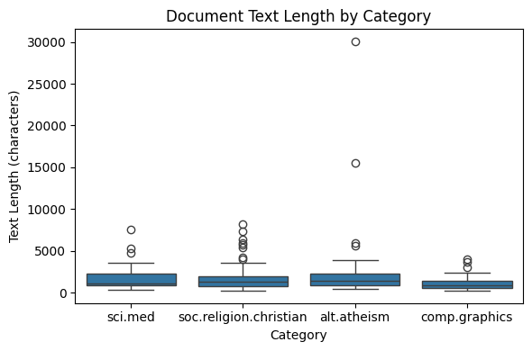

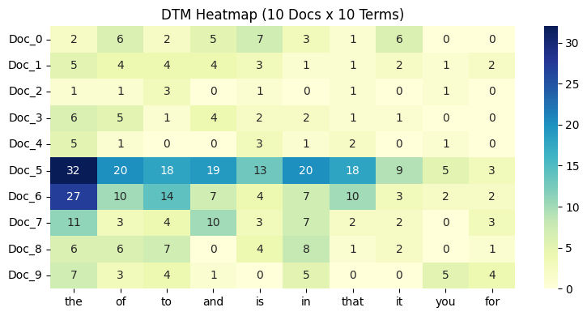

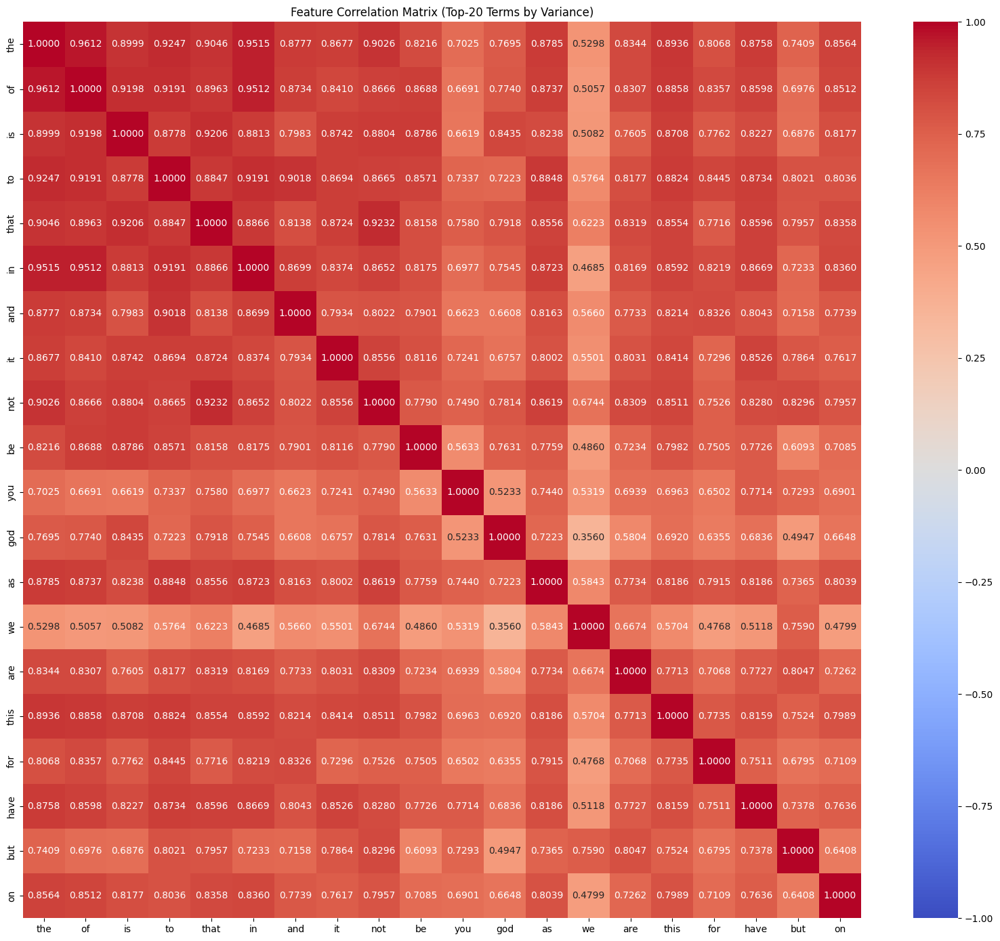

Meanwhile, the analysis from Pearson and Spearman correlation has identified words associated with each sampled category. In Pearson correlation, alt.atheism contains some relevant philosophical vocabulary, but prominent names may reflect particular contributors. In the meantime, most words from soc.religion.christian aligned with its category such as "christ" or "jesus", similar to comp.graphics and sci.med that has strong evidence that its words terms associated with the category (Napon_Jirapakatawee_agentic-pipeline_plot_turn36.png, Napon_Jirapakatawee_agentic-pipeline_plot_turn44.png, Napon_Jirapakatawee_agentic-pipeline_plot_turn52.png, Napon_Jirapakatawee_agentic-pipeline_plot_turn60.png). The Spearman correlation results illustrate similar outcome, except for the word "atheists" in alt.atheism which gain a better spotlight compare to Pearson correlation. In addition, Spearman Correlation explicitly highlights religious vocabulary into higher ranks in soc.religion.christian category compare to Pearson. (Napon_Jirapakatawee_agentic-pipeline_plot_turn82.png, Napon_Jirapakatawee_agentic-pipeline_plot_turn86.png, Napon_Jirapakatawee_agentic-pipeline_plot_turn90.png, Napon_Jirapakatawee_agentic-pipeline_plot_turn94.png) This suggest that word-count rankings may capture category associations that are less prominent when using raw word counts.

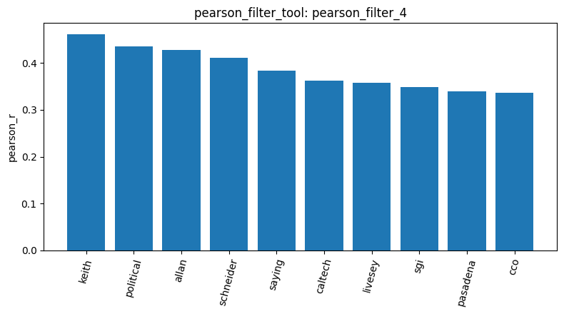

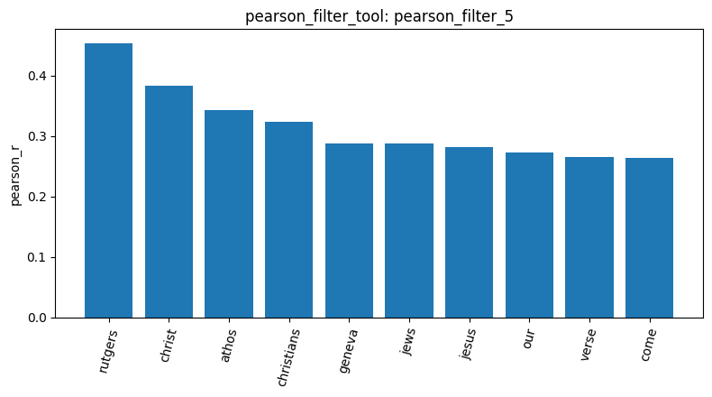

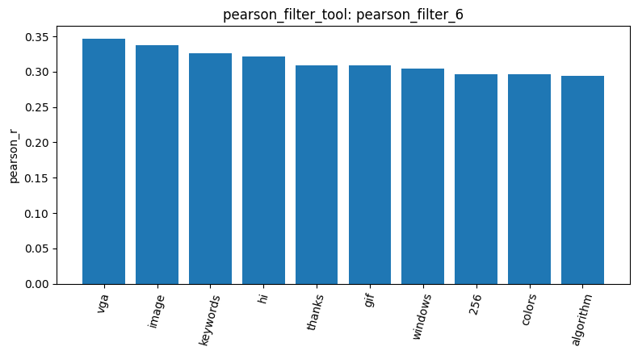

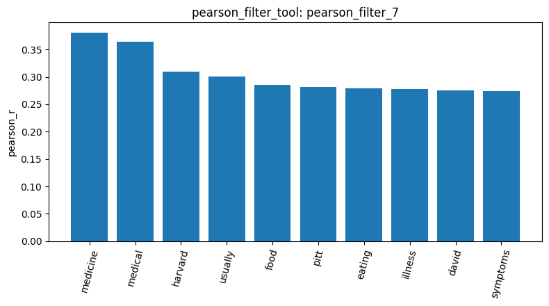

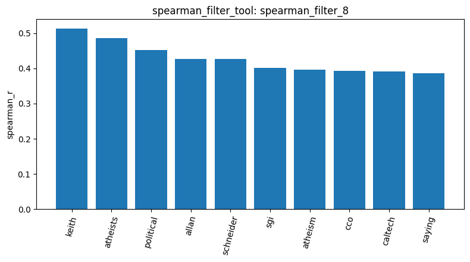

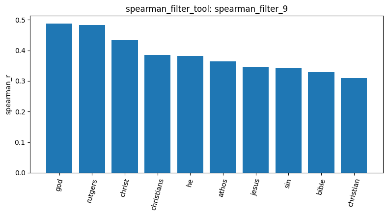

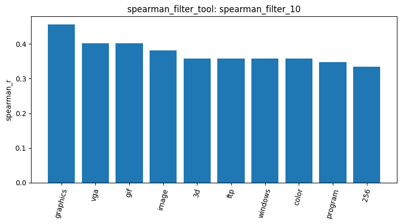

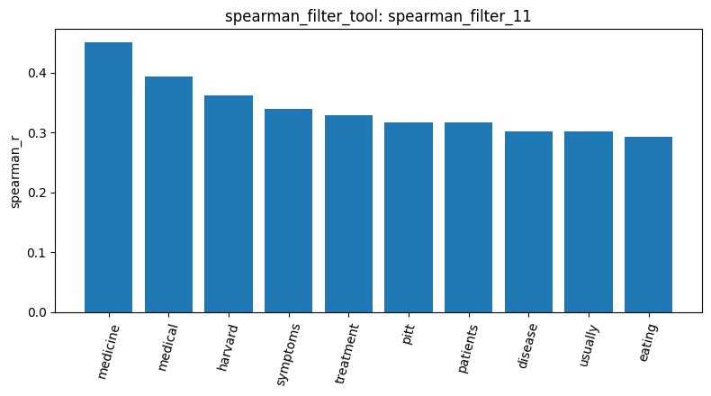

Dimensionality reduction of PCA,t-SNE and UMAP has been implemented to examine whether the three sentiment categories formed distinguishable groups. The PCA visualization shows intense clustering in all category with some outliers of alt.atheism. Such clustering therefore cannot provide clear separation between the four categories in two dimensions, while the outlier might come from unusually long documents which aligned with the boxplot results in the first paragraph. Meanwhile, the UMAP visualization has been perform with neighbor value of 2 and 3 respectively. Because the colors are overlapping, this suggests that documents from different categories may share similar vocabulary with some distinction such as alt.atheism and sci.med. t-SNE illustrated partial grouping with substantial overlap; several clusters of soc.religion.christian and comp.graphics can be observed in different areas of the graph. Nevertheless, there are still observable overlaps between categories, further supporting other dimensionality reduction results that different categories may contain overlapping word-frequency patterns. (Napon_Jirapakatawee_agentic-pipeline_plot_reduction_5.png, Napon_Jirapakatawee_agentic-pipeline_plot_reduction_8.png, Napon_Jirapakatawee_agentic-pipeline_plot_reduction_10.png, Napon_Jirapakatawee_agentic-pipeline_plot_reduction_6.png)

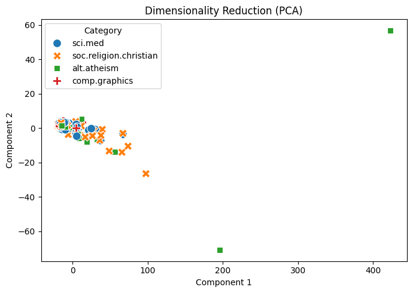

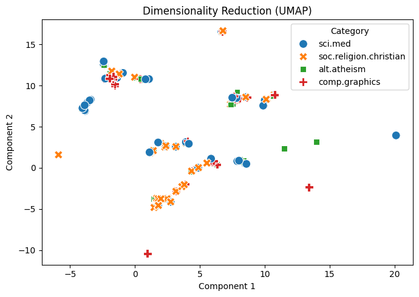

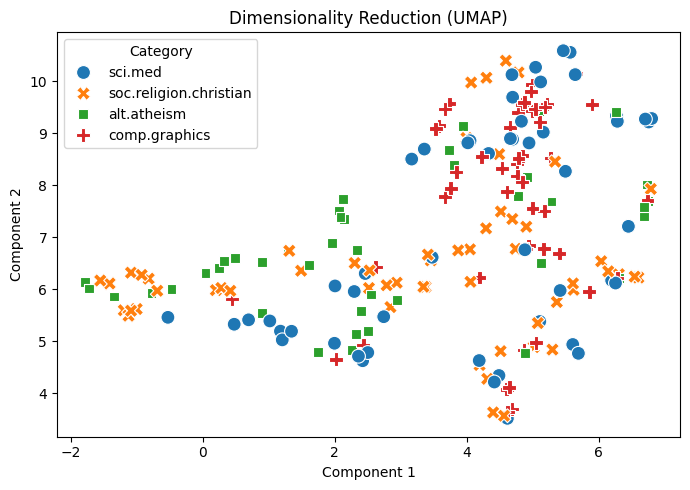

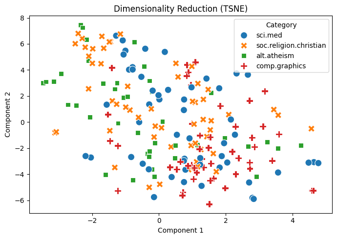

Cosine similarity analysis reveal moderate vocabulary similarity between paired observed groups with some document samples: alt.atheism and soc.religion.christian, comp.graphics and soc.religion.christian. The observed similarity may partly result from common stopwords that were not removed during preprocessing. Consequently, these shared terms may make it more difficult to distinguish document topics using raw word-frequency representations alone. (cosine_sim_14, cosine_sim_25)