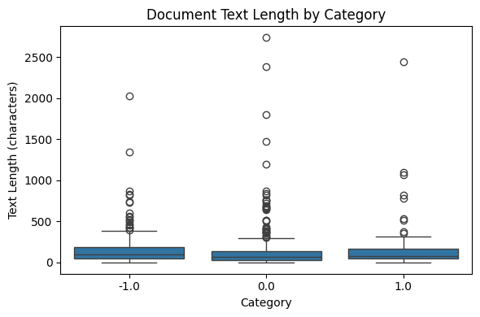
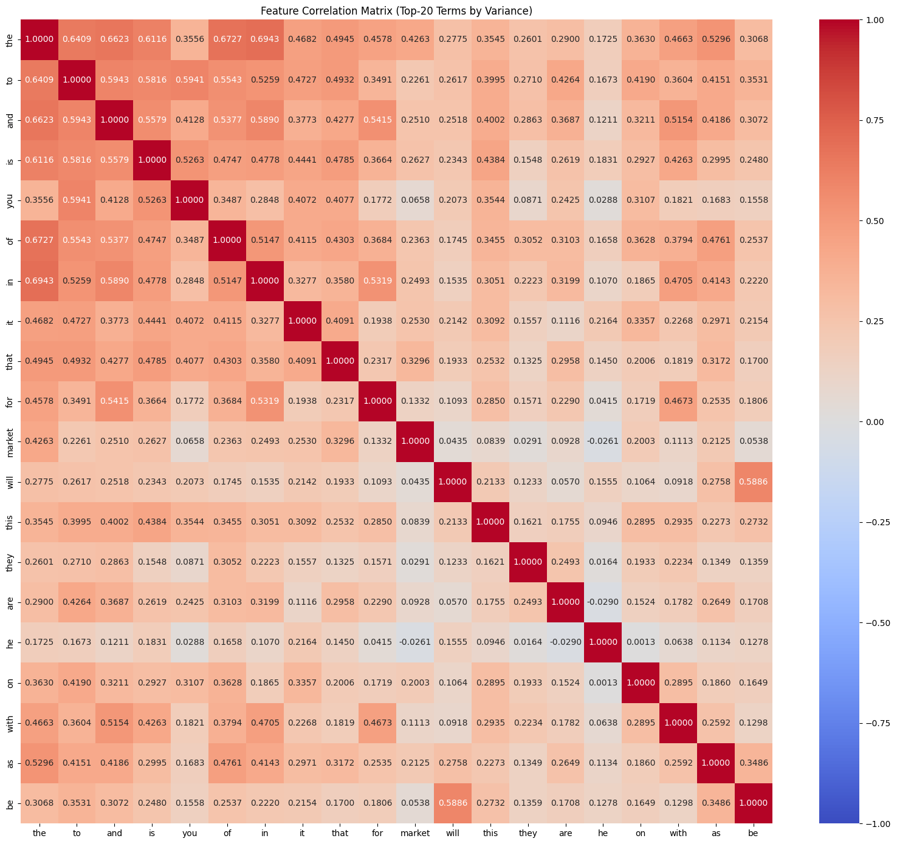
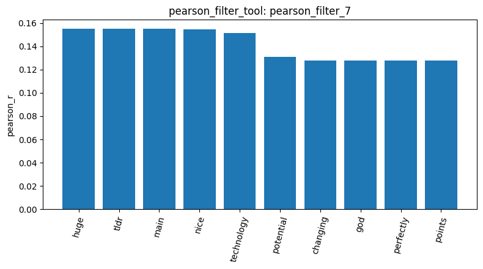
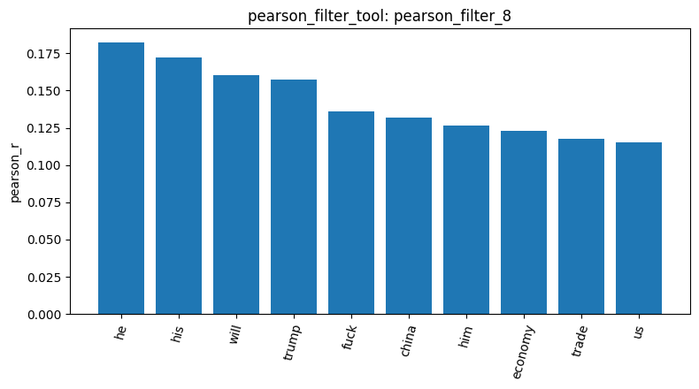
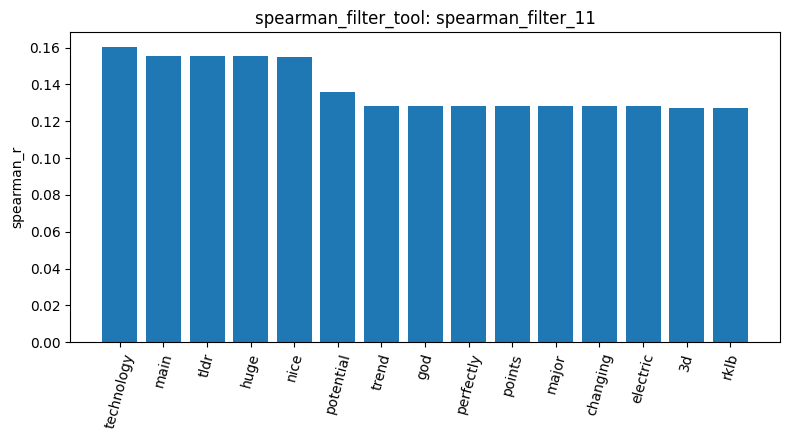
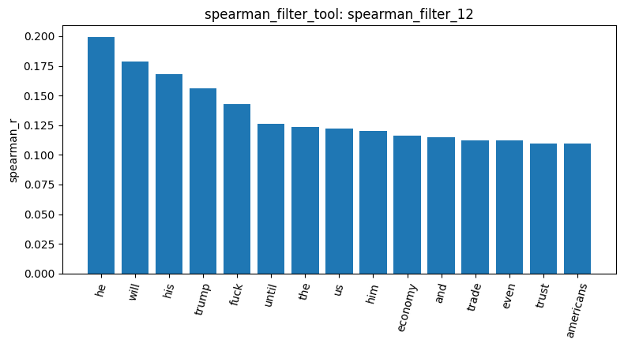
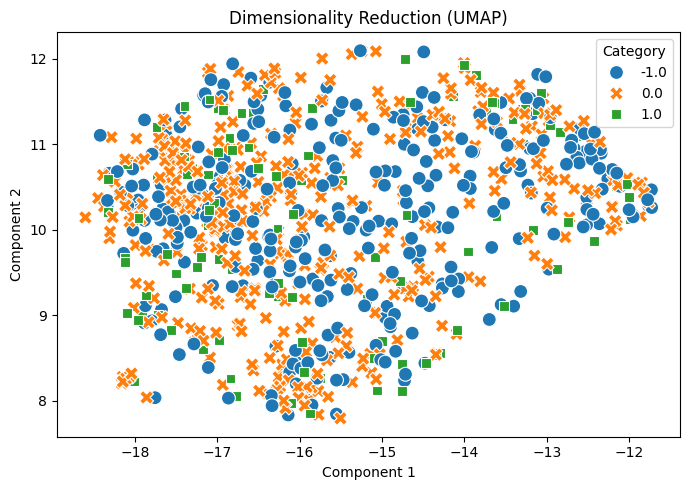
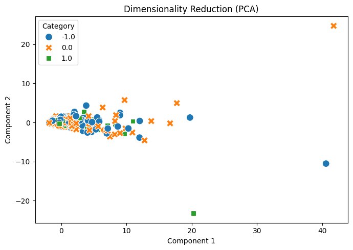

# Homework Report - Napon Jirapakatawee (115065428)

The following dataset describe the Stock Sentiment from discussions in Reddit. The goal is to investigate whether word usage could distinguish negative, neutral, or positive sentiments in financial discussion. The experiment has been conducted with 824 posts (describe_data_8) remained: 315 negative, 401 neutral, and 108 positive after removing duplicates (check_duplicates_2). Most of the post are short to medium in length, with the average post length of 147 characters and median of 78 characters. The longest post reaches 2,737 characters which has been considered as an outlier.

The Document-Term Matrix contains 4,346 vocabulary terms (dtm_3). The most frequent words (term_freq_9) were common stopwords, including "the" (886), "to" (557), and "and" (475), which explains the reason that correlation heatmap (Napon_Jirapakatawee_homework_plot_feature_corr_3.png) is difficult to interpreted. 

Variance filtering with threshold has been applied as 0.01 and 0.05, which retains 506 features and 97 features respectively. Investigation of the survived terms between threshold 0.01 (variance_filter_3) and 0.05 (variance_filter_5) suggested that more aggressive filtering could exclude potentially informative sentiment words and therefore should not be used, such as "better," "love," "bad," and "losing."

Meanwhile, the analysis from Pearson and Spearman correlation has identified words associated with positive and negative sentiments. Positive sentiment showed weak association in Pearson correlation (pearson_filter_7) with the terms such as "huge", "nice", and "potential", while negative sentiments (pearson_filter_8) was associated with "fuck", "economy", and "trade". 

On the other hand, Spearman correlation highlighted similarly to Pearson correlation in positive sentiments, while the term such as "he", "trump", and "fuck" were highlighted in negative sentiments. This indicates that positive sentiment is associated with a few positive-sounding words, while negative sentiment appears more strongly associated with the topics and language used in particular discussions. 

Because most words in negative segments did not inherently express either negativity or positivity, there could be a particular discussion topics or writing styles are associated with negative-labeled posts in this dataset. According to the data, this suggests that economic and political discussions are prominent among negative-labeled posts, while the positive discussions may talks about potential, chances, or opportunities in a good way.

The pattern mining results of FP-Growth with TF-IDF filtering has discovered 13 negative patterns (patterns_5) at 15 minimum support, 6 neutral patterns (patterns_6) at 20 minimum support, and 16 positive patterns (patterns_7) at 5 minimum support. The difference in number of minimum support is derived from difference in number of records in each label. These findings indicate some differences in vocabulary across sentiment categories, even though many frequent terms describe economic topics.

Finally, dimensionality reduction of PCA and UMAP has been implemented to examine whether the three sentiment categories formed distinguishable groups. The UMAP visualization (Napon_Jirapakatawee_homework_plot_reduction_10.png, reduction_10) showed considerable overlap between negative, neutral, and positive posts, with positive posts scattered among the other categories rather than forming a separate cluster. This suggested that vocabulary are shared among sentiment groups. 

PCA also showed limited sentiment separation (Napon_Jirapakatawee_homework_plot_reduction_9.png, reduction_9), with most documents concentrated near the origin and a few extreme outliers. These outliers may be influenced by unusual document lengths or large raw term counts. From these results, it suggests that word-frequency features reveal some sentiment-associated vocabulary but do not clearly separate financial sentiment categories in two-dimensional projections.

In conclusion, word usage revealed some differences between negative, neutral, and positive sentiment in Reddit financial discussions. Pearson and Spearman correlations identified sentiment-associated terms, while FP-Growth showed differences in frequently occurring vocabulary across categories. Nevertheless, many identified words, especially in negative sentiments, were related to economic and political discussion topics rather than sentiment itself. PCA and UMAP visualizations later showed significant overlap between the three sentiment groups, suggesting that raw word-frequency representations do not clearly distinguish them in two dimensions. Therefore, although vocabulary provides some useful sentiment-related information, it cannot be established that word frequencies alone can reliably classify Reddit posts by sentiment. Future improvements includes stopword removal, text normalization, and context-aware language representations, followed by classification evaluation to determine whether sentiment distinctions can be identified more accurately.